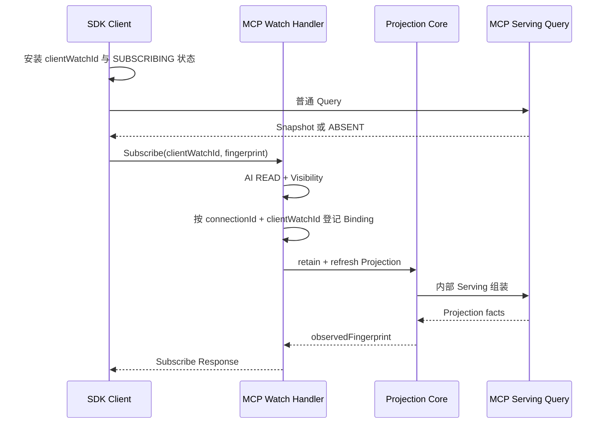

# Nacos MCP Watch 与 Subscribers 设计评审

> 对应 Issue：[#14013](https://github.com/alibaba/nacos/issues/14013)  
> 目标分支：`develop`  
> 文档状态：评审草案  
> 评审结论：方向通过，按本文“评审门槛”补齐 Spec 后进入实现  
> 最后核对：2026-11-11

## 1. 摘要

Issue #14013 的表象是：MCP Client 已经能够发现并使用 MCP Server，但 Console 的 Naming
Subscribers 列表中看不到对应客户端。根因不是 Console 查询错误，而是当前 MCP Subscription
采用客户端定时 Query 的轮询方式，没有在 Naming 或 AI Server 中建立服务端订阅状态。

讨论已经形成以下共识：

1. MCP 使用独立的 MCP Watch，不伪装成 Naming `subscribeService`。
2. Push 仅发送失效提示，完整 `McpServerDetailInfo` 始终通过普通 MCP Query 获取。
3. Watch Binding 归属于当前客户端连接，只保存在连接所在节点，不持久化、不跨节点复制。
4. MCP Subscribers 使用独立的 Admin、Console 和 Maintainer SDK 管理视图。
5. 新旧节点通过连接级 Ability 协商；不支持 MCP Watch 时继续使用现有 Polling。
6. MCP Watch 不应平行复制 Agent Watch，而应抽取可复用的 AI Watch Core，由 Agent 和 MCP
   提供各自的领域适配器。

本评审认为整体方向可行。实现前必须解决以下问题：

- 首次通知可能早于 Subscribe Response 的竞态；
- ACK 后 Query 失败、并发失效、重连后旧 Query 迟到的恢复闭环；
- 共享 Projection 与每个 Binding 的权限状态隔离；
- `SYNCING`、`LIFECYCLE_MANAGED` 和 Naming 变化的实际事件及读取屏障；
- Fingerprint 的跨客户端、跨 JSON 实现稳定性；
- 节点级 Binding、Projection、内存、重算和 Push 背压；
- Agent Watch 公共化时的协议兼容策略。

## 2. Issue 讨论总结

### 2.1 问题确认

- 2025-12-09：确认 MCP Endpoint 注册属于生产者注册；Naming Subscribers 只展示调用过
  `subscribeService` 的客户端。
- 2025-12-11：维护者确认 MCP Subscription 尚未实现服务端 Push，当前通过 Polling 感知变化，
  并欢迎贡献完整订阅能力。
- 2026-08-26：维护者确认目标是实现真正的订阅，并在服务端形成可展示的订阅状态。

### 2.2 第一版方向

第一版方案确定：

- 保持 `AiService#subscribeMcpServer`、`AiService#unsubscribeMcpServer` 和现有 Listener 契约；
- 新增 MCP Subscribe、Unsubscribe、Notify 协议和 Ability；
- 服务端维护连接级 Binding、MCP Target 和 Naming Dependency 索引；
- Push 只提示失效，客户端重新执行 MCP Query；
- 增加独立 MCP Subscribers 页面，不复用 Naming Subscribers。

### 2.3 生命周期重构后的调整

在 MCP 生命周期 API 重构完成后，方案调整为观察 Serving Projection：

- Projection 通过 `McpCompatibilityOperationService#getServingMcpServerDetail` 对应的 Serving
  组装路径生成；
- 同时兼容 `SYNCING` 和 `LIFECYCLE_MANAGED`；
- 生命周期数据变化不是立即通知条件，必须等待 Manifest、Config、Naming 等 Serving 数据在
  当前节点可读；
- `LATEST` 只解析到 Online Version，并跟随 Offline、Delete、重新选主变化；
- Naming Dependency 从实际 Serving Query 解析结果取得，不根据原始 `serviceRef` 猜测。

### 2.4 维护者补充的七类问题

维护者认可总体方向，并要求补充：

1. Subscribe Response 与早到 Notification 的竞态；
2. ACK 后数据刷新及失败恢复闭环；
3. 完整 AI READ 与 Visibility 的后台重校验边界；
4. 集群事件、读取路径和“数据已可见”的判断；
5. 周期校准的实际恢复时限；
6. Fingerprint 的集合顺序、数字、默认值和算法版本；
7. 节点级资源预算、背压、降级 Polling QPS 和压测依据。

### 2.5 最新维护者意见

最新意见认为方案整体可行，并要求评估与 Agent Watch 的一致性以及大规模复用可能性。

核对当前实现后结论是：Agent Watch 与 MCP Watch 在订阅生命周期、调度、投影、Push/ACK、
重连和 Listener 交付层面高度一致；Target、Query、Projection、事件源、Fingerprint 和权限模型
不同。正确复用方式是抽取通用 Core，不是把 Agent 领域类改名为 MCP 类。

## 3. 目标与非目标

### 3.1 目标

- 用服务端感知的 MCP Watch 替代 gRPC 场景下的稳态 Polling。
- 保持现有 Java SDK Public API 和 Listener 行为兼容。
- 观察完整 MCP Serving Query 投影，而不是只观察 Naming Instance。
- 支持 MCP、Tools、Resources、Version、Latest、Endpoint 和 Naming Instance 变化。
- 支持多节点写入、本地可见后通知、断线重连和滚动升级。
- 提供可查询、可分页、可表达部分失败的 MCP Subscribers 管理视图。
- 在资源达到上限时有界降级，不造成 Push 或 Query 风暴。

### 3.2 非目标

- 不把 MCP Watch 注册为 Naming Subscriber。
- 不在 Push 中传输完整 Server、Tools、Resources、Endpoint 或 Instance 内容。
- 不在节点间复制连接级 Binding。
- 不改变 MCP Runtime Endpoint 的 Naming 所有权、Heartbeat 或 Redo 语义。
- 不改变现有 `McpServerDetailInfo`、Listener Public API 或 Query 权威来源。
- V1 不实现跨节点全局有序通知，也不提供全量无条件 Subscribers 扫描。
- V1 不为 HTTP 增加 MCP Long Poll；HTTP 和能力不满足的 gRPC 继续 Polling。

## 4. 现状与约束

### 4.1 当前 MCP Subscription

当前客户端由 `NacosMcpServerCacheHolder`：

- 为 `mcpName + version` 创建定时更新任务；
- 周期执行协议无关 MCP Query；
- 比较新旧完整结果；
- 变化后发布本地事件并通知 Listener。

当前方案正确但存在两个限制：

- 无变化时仍持续 Query；
- 服务端没有 Binding，Console 无法展示真实 MCP Consumer。

### 4.2 当前 Agent Watch 可复用能力

客户端已有：

- `AgentWatchManager`：身份、准入、缓存、刷新和恢复编排；
- `AgentWatchSubscription`：订阅状态、激活屏障和恢复进度；
- `AgentWatchListenerDispatcher`：Listener 串行交付、补发和异常隔离；
- `AgentWatchTransportRouter`：gRPC、HTTP Batch Long Poll、Polling 路由；
- `GrpcAgentWatchTransport`：连接级 Wire Binding、重连重新订阅和 Notify ACK。

服务端已有：

- `AgentGrpcWatchRegistry`：`(connectionId, clientWatchId)` 幂等注册及索引；
- `AgentGrpcWatch`：Binding 状态、Dirty、Delivery 和 ACK 状态；
- `AgentProjectionService`：Projection 引用计数、刷新、重试和校准；
- `AgentProjectionRegistry`：逻辑及 Naming 反向依赖索引；
- `AgentProjectionTaskEngine`：合并、延迟和条带化任务执行；
- `AgentProjectionEventSubscriber`：Agent、Storage 和 Naming 事件接入。

### 4.3 当前 Agent Watch 不能直接复用的部分

- Agent Target 和 MCP Target 身份不同；
- Agent Discover 与 MCP Serving Query 返回模型不同；
- Agent Canonicalizer 不能表达 MCP 的集合字段排序规则；
- Agent Event Subscriber 不覆盖 MCP Lifecycle、Manifest、Tools 和 Resources；
- 当前 Agent 后台 Eligibility Check 主要覆盖 Visibility，不能等同完整 AI READ；
- Agent Notify 当前只携带 `watchKey`，客户端收到 Subscribe Response 后才安装 Wire Key，仍存在
  早到 Notification 窗口；
- Agent Unsubscribe 当前依赖 `watchKey`，无法单独处理 Subscribe Response 丢失后的清理。

因此，应复用机制并提取抽象，不应让 MCP 依赖 Agent 的具体 DTO 或 Projection。

## 5. 总体架构

```text
Java SDK Public API
  -> McpWatchAdapter
     -> AI Watch Client Core
        - Canonical local intent
        - Subscription state
        - Dirty / generation / retry
        - Listener dispatcher
        - Transport selection
           -> MCP gRPC Watch
           -> MCP Query Polling fallback

MCP gRPC Handler
  -> AI Watch Server Core
     - Binding registry
     - Projection registry
     - Dirty merge / retry / reconcile
     - Push / ACK delivery
     - Capacity and metrics
        -> MCP Watch Domain Adapter
           - Target canonicalizer
           - Serving projector
           - Event source adapter
           - Fingerprint canonicalizer
           - Authorization evaluator
              -> McpCompatibilityOperationService serving assembly
              -> MCP lifecycle/config/storage events
              -> Naming ServiceChangedEvent
```

### 5.1 复用原则

公共 Core 只拥有生命周期和调度语义，不拥有 Agent 或 MCP 业务字段。

| 层次 | 复用 | 领域独立实现 |
| --- | --- | --- |
| Client Intent | 状态机、Dirty、Generation、Retry、Listener 分发 | Target、Query、Result、Fingerprint |
| Transport | 连接 Epoch、重订阅、ACK、降级框架 | Payload、Ability、HTTP 是否支持 Watch |
| Server Binding | 注册、幂等、清理、Delivery、ACK | Owner Snapshot、领域错误映射 |
| Projection | 引用计数、Dirty 合并、调度、校准、反向索引框架 | Projector、Dependency 类型、Revision Barrier |
| Security | ALLOWED/DENIED/UNCERTAIN 状态机 | Agent/MCP 权限与 Visibility 计算 |
| Observability | 指标命名规则、队列和恢复指标 | `agent`/`mcp` Domain Label |

### 5.2 建议的公共接口

类名是设计建议，不是最终 API：

```text
Client:
  AiWatchManager<Target, Snapshot, Listener>
  AiWatchSubscription<Target, Snapshot>
  AiWatchTransport<Target>
  AiWatchListenerDispatcher<Snapshot, Listener>
  AiWatchQueryAdapter<Target, Snapshot>

Server:
  AiWatchBinding<TargetKey>
  AiWatchBindingRegistry<TargetKey>
  AiProjectionRegistry<TargetKey, DependencyKey>
  AiProjectionScheduler<TargetKey>
  AiWatchDeliveryEngine<TargetKey>
  AiWatchDomainAdapter<Target, Snapshot, DependencyKey>
  AiWatchAuthorizationEvaluator<TargetKey>
```

Client 与 API 模块必须保持 Java 8 兼容，公共抽象不能依赖 Java 17 专有语言特性。

## 6. 领域模型

### 6.1 MCP Watch Target

```text
McpWatchTarget = namespaceId + mcpName + selector

selector:
  LATEST
  EXACT(version)
```

规则：

- `LATEST` 与 `EXACT(version)` 始终是不同 Target；
- 即使 Exact Version 当前就是 Latest，也不能合并身份；
- `LATEST` 指向另一个 Version 时必须产生变化；
- Target 身份不包含调用方身份或权限结果；
- 同一 SDK 实例内相同 Target 只建立一个远程 Watch，多个 Listener 共享缓存和刷新任务。

### 6.2 Projection

```text
McpProjection
  target
  state: PRESENT | ABSENT
  resolvedVersion
  namingDependencies
  fingerprint
  sourceRevisionBarrier
  refreshedAt
```

Projection 不长期保存完整 `McpServerDetailInfo`。完整结果只在重算期间存在，用于计算
Fingerprint 和 Dependency；客户端完整缓存仍由普通 Query 物化。

### 6.3 Binding

```text
McpWatchBinding
  connectionId
  clientWatchId
  watchKey
  targetKey
  authorizationState
  identitySnapshot
  acknowledgedFingerprint
  pendingFingerprint
  deliveryInFlight
  subscribedAt
```

身份规则：

- `(connectionId, clientWatchId)` 是幂等身份；
- `watchKey` 是当前节点和当前连接范围内的不透明令牌；
- `watchKey` 不能跨重连复用；
- ACK、投递和授权状态按 Binding 保存，不能放入共享 Projection。

### 6.4 客户端本地状态

```text
McpLocalSubscription
  clientWatchId
  target
  state
  connectionEpoch
  invalidationGeneration
  completedGeneration
  queryInFlight
  dirty
  retryAttempt
  materializedFingerprint
  listeners
```

## 7. Public API 与 Listener 兼容

保持以下接口不变：

- `AiService#subscribeMcpServer`；
- `AiService#unsubscribeMcpServer`；
- `McpService#subscribeMcpServer`；
- `McpService#unsubscribeMcpServer`；
- `AbstractNacosMcpServerListener`。

行为保持：

- 首次 Query 存在时，方法返回完整 `McpServerDetailInfo`，Listener 接收当前结果；
- 首次 Query 不存在时，方法返回 `null`，不向 Listener 发送 `null`；
- Target 删除后清理缓存，不回调 `null`，但保留本地订阅意图；
- 同名 Target 重新创建后，Listener 收到新的完整结果；
- Fingerprint 不变时不重复回调；
- 一个 Listener 异常不影响缓存、Watch 或其他 Listener；
- 移除最后一个 Listener 时才取消远程 Watch。

## 8. Ability 与传输选择

新增连接级 Ability：

| 方向 | 常量 | Wire Key |
| --- | --- | --- |
| Server | `SERVER_MCP_WATCH_V1` | `mcpWatchV1` |
| SDK Client | `SDK_MCP_WATCH_V1` | `mcpWatchV1` |

启用 gRPC MCP Watch 必须同时满足：

- `SERVER_MCP_REGISTRY`；
- `SDK_MCP_REGISTRY`；
- `SERVER_MCP_WATCH_V1`；
- `SDK_MCP_WATCH_V1`。

传输规则：

| SDK Transport | 行为 |
| --- | --- |
| `HTTP` | 继续使用现有 MCP Query Polling。 |
| `GRPC` | Ability 完整时使用 Watch，否则 Polling。 |
| `AUTO` | 当前连接和 Ability 完整时使用 gRPC Watch，否则由 Query Router 选择传输并 Polling。 |

Ability 缺失、Unknown、滚动升级连接到旧节点或连接切换时，都不能发送 MCP Watch Payload。
404、参数校验、鉴权和 Visibility 错误不触发跨传输降级。容量拒绝只让订阅机制降级为
Polling，不改变 Query Transport。

## 9. gRPC 协议

### 9.1 Payload

| Request | Response | 说明 |
| --- | --- | --- |
| `McpSubscribeRpcRequest` | `McpSubscribeRpcResponse` | 建立或幂等恢复连接级 Binding。 |
| `McpUnsubscribeRpcRequest` | `McpUnsubscribeRpcResponse` | 幂等取消 Binding。 |
| `McpServerNotifyRequest` | `McpServerNotifyResponse` | 发送失效或重校验提示并接收 ACK。 |

### 9.2 Subscribe Request

字段：

- `namespaceId`；
- `mcpName`；
- 可选 `version`；
- `clientWatchId`；
- 可选 `materializedFingerprint`。

`clientWatchId` 在一个 SDK 实例内唯一，在本地 Intent 生命周期中保持不变；关闭后不复用。

### 9.3 Subscribe Response

字段：

- `watchKey`；
- `observedFingerprint`；
- `refreshRequired`；
- 可选 `retryAfterMillis`；
- 标准错误码。

Response 不携带完整 MCP 内容。

### 9.4 Unsubscribe

Request 携带：

- `clientWatchId`；
- 可选 `watchKey`。

同时支持两个标识是为了处理 Subscribe Response 丢失：客户端可能尚未取得 `watchKey`，但仍需
取消由同一 `(connectionId, clientWatchId)` 创建的 Binding。

### 9.5 Notification

字段：

- `watchKey`；
- `clientWatchId`；
- `eventType`；
- 可选 `observedFingerprint`；
- 可选 `errorCode`。

V1 Event：

| Event | 语义 |
| --- | --- |
| `INVALIDATE` | Target 可能变化，客户端执行普通 Query。 |
| `REVALIDATE` | 不携带内容和 Fingerprint，客户端使用当前凭证 Query 并重新建立或激活 Watch。 |
| `TERMINATED` | 当前 Binding 已终止，客户端根据错误决定降级、等待或结束 Wire Binding。 |

ACK `accepted=true` 只表示客户端已经原子记录刷新意图并成功调度任务，不表示 Query 已完成。

## 10. Subscribe 状态机与竞态

### 10.1 客户端状态

```text
LOCAL_PENDING
    -> SUBSCRIBING
    -> ACTIVE
    -> DEGRADED_POLLING
    -> CANCEL_PENDING
    -> CLOSED
```

`DEGRADED_POLLING` 可以因能力缺失、容量拒绝或临时 Wire 不可用进入。连接变化或
`retryAfterMillis` 到期后可以重新尝试 Subscribe。

### 10.2 服务端状态

```text
SUBSCRIBING -> ACTIVE -> SUSPENDED -> ACTIVE
       |          |          |
       +----------+----------+-> CLOSED
```

- `SUBSCRIBING`：Binding 已登记，Projection 正在建立；
- `ACTIVE`：允许发送数据变化 Notification；
- `SUSPENDED`：权限不确定或投递受背压，保留 Binding 但暂停业务变化通知；
- `CLOSED`：已取消、连接断开或终止。

### 10.3 建立流程



关键规则：

1. 客户端发送 Subscribe 前先安装 `clientWatchId` 索引。
2. 服务端先登记 Binding，再建立 Projection，覆盖首次 Query 与订阅建立之间的变化。
3. Notification 同时携带 `clientWatchId` 和 `watchKey`。Push 早于 Response 时，客户端通过
   `clientWatchId + connectionEpoch` 识别并记录 Dirty。
4. 相同 `(connectionId, clientWatchId)` 的 Subscribe 重试返回同一 Binding 和 `watchKey`；
   同一 ID 对应不同 Target 返回 Conflict。
5. Response 丢失时，客户端可以使用相同 `clientWatchId` 重试。
6. Unsubscribe 与 Subscribe 并发时，服务端为取消中的 ID 保留有界 Tombstone。Tombstone 受
   每连接数量限制并在连接关闭或 TTL 到期后清理，防止迟到 Subscribe 重新创建 Binding。
7. 迟到 Response、旧 Notification、旧 Unsubscribe 和旧 Query 都由 `connectionEpoch` 隔离。

## 11. ACK 后刷新闭环

收到有效 Notification：

```text
invalidationGeneration++
dirty = true
scheduleRefresh()
ACK accepted=true
```

Query 启动时捕获：

```text
startedEpoch = connectionEpoch
startedGeneration = invalidationGeneration
```

Query 完成规则：

1. Epoch 已变化：丢弃结果，不更新缓存和 Listener。
2. Query 期间出现更高 Generation：可以应用本次结果，但不能清除 Dirty，立即再次 Query。
3. Query 失败：不清除 Dirty，按 `1/2/4/8/16/30s` Full Jitter 退避。
4. 快速重试耗尽：进入 30 秒慢恢复通道，直到成功、取消或关闭。
5. Query 成功且 Fingerprint 不变：推进 `completedGeneration`，不回调 Listener。
6. Query 成功且 Fingerprint 变化：原子替换缓存，再串行通知 Listener。
7. 任一时刻每个 Target 最多一个 Query 在执行，重复 Notification 只合并 Generation。

该闭环不依赖“下一次 Push”才能恢复，因此 ACK 丢失、Push 重试耗尽或后续没有变化时，客户端仍会
最终重新物化权威状态。

## 12. MCP Serving Projection

### 12.1 读取路径

`McpProjectionProjector` 应复用 `McpCompatibilityOperationService` 后面的 Serving 组装逻辑，
不能分别读取 Resource、Config、Manifest 和 Naming 后再拼装第二套结果。

共享 Projector 使用服务端内部、无调用方过滤的事实读取路径。Public Client Query 仍使用普通鉴权
路径。由 Public Query 返回的 NOT_FOUND 不能反写共享 Projection。

### 12.2 观察范围

- MCP Server 基础信息；
- Tools；
- Resources；
- Exact Version；
- Latest Version 指针；
- Online、Offline；
- Delete、Recreate；
- `serviceRef`；
- Direct、Service Ref、Client Runtime Endpoint；
- 实际关联 Naming Service 的 Instance。

### 12.3 Naming Dependency

- Dependency 必须来自实际 Serving Query 解析出的 Service 坐标；
- 即使当前 Instance 列表为空，也保留 Service Dependency；
- 首个 Instance 出现时，`ServiceChangedEvent` 仍能找到目标；
- Latest 或引用关系变化时，原子替换旧反向索引，再触发 Notification；
- 最后一个 Projection 引用释放后清理反向索引和待执行任务。

## 13. 集群变化感知

订阅状态属于连接节点。客户端连接 Server A，而数据在 B 或 C 修改时：

1. 数据通过现有一致性或持久化机制到达 A；
2. A 在本地事实可见后产生或接收本地事件；
3. A 将受影响 Projection 标记为 Dirty；
4. A 重新读取 Serving Projection；
5. Fingerprint 变化后通知连接在 A 上的客户端。

不建立分布式 Watch Registry，也不把 NotifyCenter 当作分布式事件总线。

### 13.1 事件与读取矩阵

| 场景 | 事件来源 | 读取路径 | 重试条件 |
| --- | --- | --- | --- |
| `SYNCING` | Manifest、Server、Tools、Resources Config 本地可见事件 | Compatibility 历史 Serving 路径 | Query 尚未读到事件 Revision/MD5 |
| `LIFECYCLE_MANAGED` | AI Resource、Version Storage、Serving Manifest 本地变化 | Lifecycle Serving 路径 | Lifecycle 与 Serving Manifest 尚未收敛 |
| 模式切换 | Lifecycle Management State 变化 | 固定本次 Mode 后完整重算 | 读取组合不完整或 Mode 已变化 |
| Naming 变化 | `ServiceChangedEvent` | Query 实际解析的 Service | Service Revision 未达到事件屏障 |
| 漂移恢复 | 周期 Reconcile | 当前 Serving 路径 | Projection 失败或 Fingerprint 变化 |

事件只作为失效提示。事件有可比较 Revision 时，Projector 返回实际观察到的 Revision；未达到屏障则
保持 Dirty。事件没有 Revision 时，至少执行一次延迟复读，并依赖有界重试和周期 Reconcile 兜底。

## 14. Fingerprint

新增 Client/Server 共用、Java 8 兼容的 `McpProjectionCanonicalizer`。

格式：

```text
sha256-mcp-query-v1:<hex>
```

Canonical Frame 包含：

- `PRESENT` 或 `ABSENT`；
- Selector 类型和请求 Version；
- `resolvedVersion`；
- V1 字段白名单中的完整 MCP Query 结果。

规则：

- Object/Map Key 按字典序；
- `null`、字段缺失、空字符串和空集合保持区分；
- 数字使用规范十进制，`-0` 归一为 `0`，拒绝 NaN/Infinity；
- Naming Instance、Endpoint 等集合语义字段按稳定业务键及元素摘要排序；
- Tools、Resources 中有契约顺序的数组保留顺序，无顺序语义的集合排序；
- 新增模型字段不会静默进入 V1；等价规则变化时升级算法版本；
- 默认 JSON 与 Jackson 3 Adapter 不参与 Canonical 规则定义，只消费同一 Canonicalizer。

共享测试向量至少覆盖：Map 换序、Instance/Endpoint 换序、有序数组、默认值、数字、Unicode、
PRESENT/ABSENT 和新增未知字段。

Fingerprint 只用于内容等价比较，不是版本号、全局顺序号或权限结果。

## 15. Push、ACK 与投递

Projection 状态和 Binding 确认状态必须分离：

1. Projection 刷新成功，记录最新 Fingerprint。
2. `ALLOWED` Binding 的确认 Fingerprint 与最新值不同，标记待投递。
3. 每个 Binding 最多一个 Notification 正在等待 ACK。
4. 只有标识匹配且 `accepted=true` 才推进确认 Fingerprint。
5. ACK 超时、网络失败、非法响应不推进确认状态。
6. 投递期间再次变化时，只保存最新待投递 Fingerprint。
7. 当前投递结束后仍未确认最新值，则继续调度。
8. 即时重试耗尽后，Binding 保持 Pending，由独立 Delivery Retry 恢复，不依赖 Projection 再变化。

Push 队列饱和时，每个 Binding 只保留一个最新 Pending 状态，不累计中间通知。

## 16. 鉴权与 Visibility

### 16.1 状态隔离

```text
Shared Projection
  -> 无调用方身份的资源事实、Dependency、Fingerprint

Connection Binding
  -> Identity Snapshot、ALLOWED/DENIED/UNCERTAIN、ACK、Delivery
```

首次 Subscribe 必须执行与普通 MCP Query 相同目标上的 Namespace、AI READ 和 Visibility 校验。

### 16.2 后台重校验

- Binding 只保存插件允许持久化的无凭证身份快照；
- 不保存 Token、密码、Cookie 或其他凭证；
- 支持身份快照重校验的插件，在发送变化通知前和独立周期任务中重新执行 AI READ 与 Visibility；
- 无法完整重校验时进入 `UNCERTAIN`，暂停业务变化通知；
- `ALLOWED -> DENIED/UNCERTAIN` 和 `DENIED/UNCERTAIN -> ALLOWED` 的授权状态转换，可以发送一次
  不含 Fingerprint 和资源信息的 `REVALIDATE`，使客户端重新确认并清理或恢复缓存；
- 客户端使用当前凭证执行普通 Query，并以同一 `clientWatchId` 重新 Subscribe 或激活；
- `DENIED/UNCERTAIN` 期间不发送目标变化通知，避免泄漏资源存在和变化时机。

### 16.3 NOT_FOUND 隔离

普通 Query 可能因 Visibility 将资源映射为 NOT_FOUND。该结果只影响对应客户端 Binding 的缓存和
交付，不得把共享 Projection 写成 ABSENT。真实 ABSENT 只能由内部 Serving Projector 确认。

### 16.4 评审要求

S1 必须明确默认鉴权插件和可插拔鉴权插件是否支持无凭证身份快照重校验。如果现有 SPI 无法表达，
不得把 Visibility Owner Check 描述为完整 AI READ；应采用 `UNCERTAIN + REVALIDATE`，或先扩展
鉴权 SPI 后再实现完整后台重校验。

## 17. Unsubscribe、断线与重连

### 17.1 Unsubscribe

- 移除最后一个本地 Listener 时发送；
- 以当前 Connection、`clientWatchId` 和可选 `watchKey` 定位；
- 幂等；
- 不能删除其他连接的 Binding；
- Response 丢失不改变本地已关闭状态；
- 服务端连接清理最终兜底。

### 17.2 Disconnect

服务端：

- 按 `connectionId` 清理全部 Binding 和 Tombstone；
- 释放 Projection 引用；
- 最后一个引用释放时清理 Projection、Dependency 和任务。

客户端：

- 保留 Canonical Local Intent 和最后已知缓存；
- `connectionEpoch++`；
- 丢弃旧 `watchKey`；
- 旧 Notification、Response 和 Query 结果失效；
- 新连接重新协商 Ability；
- 支持时使用相同 `clientWatchId` 建立新 Binding；
- 不支持时切换 Polling；
- Query 当前结果完成恢复，不重放旧连接 Push。

## 18. 周期校准与恢复 SLA

不同任务不能依赖同一个固定批量扫描：

| 任务 | 调度策略 | 恢复目标 |
| --- | --- | --- |
| Projection Refresh | 事件驱动，100ms 合并；失败 1s 起步、最大 30s | 正常事件尽快物化 |
| Delivery Retry | 每 Binding 独立有界退避 | ACK 恢复后继续投递 |
| Authorization Recheck | 固定周期加随机抖动 | 不与 Projection 扫描耦合 |
| Drift Reconcile | 每 Target `nextReconcileAt` | 所有活跃 Target 5 分钟内至少一次 |
| Client Slow Recovery | 每 Target 最大 30s 间隔 | 无新 Push 时仍最终 Query 成功 |

Reconcile 批量大小根据活跃 Target 数和 5 分钟 SLA 动态计算，不能固定为“30 秒扫描 100 个”。

## 19. 容量、资源预算与背压

### 19.1 初始配置

以下是 V1 压测前的保守候选值，不是未经验证的最终承诺：

| 配置项 | 初始值 | 说明 |
| --- | ---: | --- |
| `nacos.ai.mcp.capacity.watch.max-per-client` | `300` | 单连接 Binding 上限 |
| `nacos.ai.mcp.capacity.watch.max-bindings-per-node` | `50000` | 单节点 Binding 总量 |
| `nacos.ai.mcp.capacity.watch.max-projections-per-node` | `10000` | 单节点共享 Projection 数 |
| `nacos.ai.mcp.capacity.watch.max-estimated-bytes-per-node` | `268435456` | 候选 256 MiB，实际不超过 Heap 10% |
| `nacos.ai.mcp.watch.refresh.max-concurrency` | `max(2, min(16, CPU))` | Projection 并发重算 |
| `nacos.ai.mcp.watch.push.max-inflight` | `1024` | 等待 ACK 的 Push 数 |
| `nacos.ai.mcp.watch.push.max-qps` | `2000` | 持续 Push QPS |
| `nacos.ai.mcp.watch.push.max-burst` | `4000` | Push 短时突发 |

内存预算实际值：

```text
min(configuredMaxEstimatedBytes, JVM Max Heap * 10%)
```

### 19.2 保留内存估算

```text
estimatedRetainedBytes =
    bindingCount * bindingWeight
    + sum(projectionWeight)
    + pendingDeliveryCount * deliveryWeight
```

初始准入权重：

```text
bindingWeight =
    1024 B
    + UTF-8(connectionId, clientWatchId, watchKey, namespaceId, mcpName)

projectionWeight =
    2048 B
    + 256 B * namingDependencyCount
    + UTF-8(namespaceId, mcpName, requestedVersion, resolvedVersion)

deliveryWeight = 256 B
```

临时内存：

```text
estimatedTransientBytes =
    refreshConcurrency
    * P99(MCP Query response bytes)
    * decodeExpansionFactor
```

`decodeExpansionFactor` 必须通过 Heap Dump/JFR/JOL 压测校准，不能假设 JSON 字节数等于 Java
对象占用。准入权重是保护性计费，不是精确 Heap 统计。

### 19.3 原子准入

准入必须同时检查：

- 每连接 Binding；
- 节点 Binding；
- 节点 Projection；
- 估算保留内存；
- Refresh Queue；
- Delivery Queue。

创建 Binding、增加 Projection 引用和写反向索引必须形成原子提交。任一步失败都回滚。

Projection 首次计算后按实际 Dependency 修正预算；修正后超限时不驱逐已建立 Watch，停止新准入并
进入背压状态。

### 19.4 超限行为

- Subscribe 返回 `NacosException.OVER_THRESHOLD`；
- Response 返回建议的 `retryAfterMillis`，初始 60 秒；
- 客户端保留本地 Intent 并切换 Polling；
- 容量降级 Polling 最小间隔 30 秒，使用 Full Jitter；
- 连续失败使用 `30/60/120/300s` 退避；
- 每个 SDK 最多两个容量降级 Query 并发；
- 相同 Target 的多个 Listener 共享一个 Query；
- 只在 Retry-After 到期、连接变化或其他 Watch 释放后重试准入；
- 不能在每次 Poll 时重新 Subscribe；
- Refresh Queue 饱和时保留 Target Dirty 标志；
- Push Queue 饱和时只保留 Binding 最新 Pending Fingerprint。

## 20. MCP Subscribers 管理视图

### 20.1 API

| Surface | Method/Path |
| --- | --- |
| Admin API | `GET /v3/admin/ai/mcp/subscribers` |
| Console API | `GET /v3/console/ai/mcp/subscribers` |
| Maintainer SDK | `McpMaintainerService.listMcpSubscribers(...)` |

V1 参数：

- `namespaceId`：必填、精确匹配；
- `mcpName`：必填、精确匹配；
- `pageNo`：默认 1，最小 1；
- `pageSize`：默认 100，范围 `1..100`。

第一版不允许无条件扫描全集群订阅。

### 20.2 返回模型

```text
McpSubscriberQueryResult
  Page<McpSubscriberInfo> subscribers
  List<String> queriedNodes
  List<String> failedNodes
  boolean partial
```

`McpSubscriberInfo`：

- namespaceId；
- mcpName；
- selectorType；
- requestedVersion；
- resolvedVersion；
- projectionState；
- clientIp；
- appName；
- clientVersion；
- connectionId；
- subscribedAt；
- serverNode。

不返回 `watchKey`、`clientWatchId`、Fingerprint、凭证、Tools、Resources 或 Endpoint 内容。

### 20.3 集群聚合

1. 获取一次健康成员快照；
2. 查询本节点索引；
3. 通过有界内部 RPC 查询其他健康节点；
4. 节点按 Cursor 分批返回，每批最多 100；
5. 以 `serverNode + connectionId + clientWatchId` 内部去重；
6. 统一稳定排序后分页；
7. 至少一个节点成功时返回结果并标记 `partial=true`；
8. 全部节点失败时返回标准服务端错误，不能伪装为空页。

外部请求先对精确 MCP Target 执行 AI READ；节点间调用使用 Server Identity，不转发用户凭证。

Polling 客户端没有服务端 Binding，因此不会出现在 Subscribers 结果中。UI 必须提示该限制，避免把
列表解释为全部逻辑 Listener。

### 20.4 Console 部署

- `merged`：Inner Handler 调用本地聚合服务；
- `console`：Remote Handler 通过 Maintainer SDK 调用 Admin API；
- Console 不读取节点内存，也不自行向 Server 集群扇出；
- MCP Detail 增加独立 Subscribers 页签，部分失败时显示明确告警。

## 21. 可观测性

至少提供以下低基数指标：

- 当前 Binding、Projection、Dependency 数；
- 准入拒绝数及原因；
- 估算保留内存和预算利用率；
- Refresh Queue Size、最老 Dirty 时长、Refresh 成功/失败/重试；
- Delivery Queue Size、In-flight、Push QPS、ACK 延迟和失败；
- 最老未确认 Notification；
- Authorization State 数及重校验延迟；
- Reconcile 扫描延迟、超时 Target 数和完整扫描耗时；
- Client Watch/Polling 数、降级原因、Query 重试和 Listener 拒绝；
- Subscribers 聚合节点数、失败节点数和耗时。

日志不得输出凭证、完整 MCP Payload、完整 Fingerprint 或高基数 Target 内容。Target 和 Key 应采用
Token/摘要形式，并对重复错误限频。

## 22. 压测方案与验收门槛

### 22.1 基准环境

```text
3 节点集群
单节点 8 vCPU、4 GiB Heap
5,000 Connections
50,000 Bindings
10,000 Shared Projections
平均 3 个 Naming Dependencies
Query Response：P50 8 KiB、P95 64 KiB、P99 512 KiB
普通 Fan-out：1、10、100
热点 Fan-out：1,000
Target 变化率：100、500、1,000/s
ACK 丢失率：1%、10%、连续 60 秒 100%
Query 失败率：5%、20%
跨节点：Client 在 A，MCP 在 B 修改，Naming 在 C 修改
```

超限场景：

- 100,000 Bindings；
- 20,000 Projections；
- 单连接超过 300 Bindings；
- 达到估算内存预算；
- Push 和 Projection Queue 同时饱和；
- 大量客户端同时从 Watch 降级到 Polling。

### 22.2 必须采集

- Binding 和 Projection 实际 retained heap；
- Query 临时对象峰值和 `decodeExpansionFactor`；
- CPU、Heap、Young/Old GC、GC Pause P99；
- Projection 重算吞吐和 P99；
- Push QPS、ACK P99、In-flight；
- 降级 Polling Query QPS 和 Query P99；
- 事件本地可见到 Client Cache 收敛的 P50/P95/P99；
- Queue Size、最老 Dirty、最老 Pending Delivery；
- 断线、节点切换和故障恢复时长。

### 22.3 S1 定义的验收门槛

以下作为实现 PR 的最低门槛；若失败，必须降低默认容量或并发，而不是放宽保护：

1. 正常负载连续 30 分钟无 OOM、无任务无界增长、无已接受 Watch 永久丢失更新。
2. Watch retained heap 不超过配置预算；节点总 Heap 在稳定后不超过 Max Heap 的 70%。
3. 正常负载 CPU 平均不超过 70%，GC Pause P99 不超过 200ms，稳态不出现持续 Full GC。
4. 数据在连接节点可见后，Client Cache 收敛 P99 不超过 5 秒；无故障时最老 Dirty 不超过 30 秒。
5. 全部活跃 Projection 在 5 分钟内至少 Reconcile 一次。
6. Watch 引入后，普通 MCP Query P99 相对无 Watch 基线退化不超过 20%。
7. Push 持续 QPS、Burst 和 In-flight 不超过配置；Queue 饱和时内存保持有界。
8. ACK 连续丢失 60 秒或 Query 失败 20% 后，故障解除 2 分钟内至少 99.9% Target 收敛，
   5 分钟内全部收敛。
9. 超限时新 Subscribe 被明确拒绝，已有 Binding 不被驱逐，索引无泄漏、引用计数不为负。
10. 大规模降级 Polling 使用 Jitter 后不得形成周期尖峰；Query P99 和 Server CPU 仍满足上述门槛。
11. Cross-node 场景无永久漏通知，最终结果与直接普通 Query 一致。
12. 连续运行 2 小时后 Binding、Projection、Task 和 Thread 数无持续增长趋势。

这些门槛用于确定最终默认值。`50000/10000/256MiB/16/2000QPS` 只是压测起点；最终默认值应
记录测试环境、结果和调整依据。

## 23. 测试矩阵

### 23.1 Unit Test

- Target Canonicalization 和 `LATEST/EXACT` 隔离；
- Fingerprint 共享测试向量；
- Binding 幂等、Conflict、Tombstone、连接归属和原子回滚；
- Projection 引用计数和 Dependency 替换；
- 早到 Notification、Response 丢失、取消并发；
- Generation、Epoch、旧 Query 丢弃和慢恢复；
- ACK 超时、重复 ACK、非法 ACK、投递期间再次变化；
- 授权 `ALLOWED/DENIED/UNCERTAIN` 转换；
- 容量预算、Queue 饱和和 Retry-After；
- Listener 串行交付、Executor 拒绝和异常隔离。

### 23.2 Java SDK IT

- Exact、Latest 和 Latest 切换；
- 首次存在、不存在、Delete、Recreate；
- Server、Tools、Resources、Version、ServiceRef、Runtime Endpoint 变化；
- 多 Listener 共享和最后一个 Listener 取消；
- 连接 A、修改 B、Naming 变化 C；
- 断线后连接其他节点；
- 旧服务端能力缺失时 Polling；
- 容量拒绝后 Polling，并在 Retry-After 后恢复 Watch；
- 权限撤销、恢复和 NOT_FOUND 隔离；
- 默认 JSON 与 Jackson 3 行为一致。

同步更新 `test/java-sdk-test/JAVA_SDK_IT_COVERAGE.md` 和场景文档。

### 23.3 OpenAPI 与 Maintainer SDK IT

- Admin 参数边界、鉴权和错误映射；
- 集群聚合排序、分页、去重；
- 单节点失败、部分失败、全部失败；
- Disconnect 后清理；
- Console Inner/Remote Handler 结果一致；
- Maintainer SDK 返回模型与 Admin API 一致。

同步更新 `test/openapi-test/API_TEST_COVERAGE.md`、对应场景文档和 Maintainer SDK IT。

## 24. Spec 影响

S1 至少更新：

- `specs/zh-cn/ai/mcp-server-spec.md` 及英文镜像；
- 新增 MCP Watch/Subscription 专项 Spec，或在 MCP Server Spec 中建立独立章节；
- `specs/zh-cn/grpc-api/api-spec.md` 及英文镜像；
- `specs/zh-cn/client/client-ability-negotiation-spec.md`；
- `specs/zh-cn/client/runtime-push-reconnect-spec.md`；
- `specs/zh-cn/client/client-local-cache-redo-spec.md`；
- `specs/zh-cn/sdk/sdk-spec.md`；
- `specs/zh-cn/sdk/sdk-java-impl-spec.md`；
- `specs/zh-cn/http-api/v3-api-surface.md`；
- `specs/zh-cn/console/console-spec.md`；
- API、Java SDK、Maintainer SDK Integration Test Spec；
- 必要时补充 Auth Plugin 身份快照重校验契约。

现有规范中“`subscribeMcpServer` 继续轮询完整投影”的文本必须改为：Polling 是兼容和降级路径，
Ability 完整的 gRPC Connection 使用 MCP Watch Hint 加普通 Query。

## 25. 分阶段实施

### S1：设计与 Spec PR

- 合入本文最终确认的协议、状态机、权限、容量和测试契约；
- 不修改运行时行为；
- 明确 Agent 协议兼容选择和鉴权重校验 SPI 边界。

### S2：AI Watch Core 抽取与 Agent 迁移

- 从 Agent Watch 提取 Client/Server 公共 Core；
- Agent 通过 Adapter 继续运行；
- 修复或隔离早到 Notification 窗口；
- 保持 Agent Public API、Watch Identity 和现有传输兼容；
- 完成 Agent Unit/IT 回归后再接入 MCP。

### S3：MCP Watch Runtime

- Ability、Payload、Handler；
- MCP Client Adapter 和 Polling Fallback；
- MCP Projection、Event Source、Fingerprint、Auth Adapter；
- Capacity、Metrics、Push/ACK、Reconnect；
- Java SDK IT 和压测。

### S4：MCP Subscribers 管理能力

- Admin API 和集群聚合；
- Maintainer SDK；
- Console Proxy/Handler；
- MCP Detail Subscribers 页面；
- OpenAPI、Maintainer SDK 和 Console 测试。

分拆的原因是：公共化 Agent Watch 本身具有回归风险，不应与新 MCP 协议和 Console UI 一次性合并。

## 26. 代码影响范围

预期主要模块：

| 模块 | 影响 |
| --- | --- |
| `api` | Ability、MCP Watch Payload、Event、DTO；保持 Java 8 |
| `client` | AI Watch Core、MCP Adapter、Query/Fallback、Listener 交付 |
| `ai` | Handler、Binding、Projection、Event、Auth、Capacity、Metrics |
| `maintainer-client` | Subscribers 查询接口和模型 |
| `console` | Console API、Proxy、Inner/Remote Handler |
| `console-ui-next` | MCP Subscribers 页签 |
| `specs` | 中英文规范及 Schema/协议说明 |
| `test/java-sdk-test` | SDK Subscription 场景和 Coverage |
| `test/openapi-test` | Admin API 场景和 Coverage |
| `test/maintainer-sdk-test` | 集群 Subscribers 查询场景 |

## 27. 评审发现与处理建议

### 27.1 已通过的设计决策

- MCP 独立 Watch，不复用 Naming Subscription；
- Push 只失效、Query 才权威；
- Connection-local Binding；
- 独立 MCP Subscribers 视图；
- Ability 协商和 Polling 降级；
- `LATEST/EXACT` 身份分离；
- 共享 Projection 与 Binding Delivery/Auth 分离；
- 节点级容量和有界任务队列；
- 优先抽取 Agent/MCP 共用 Watch Core。

### 27.2 实现前必须关闭

1. **Agent 协议兼容策略**：给 Agent Notify/Unsubscribe 增加可选 `clientWatchId` 是否仍属于
   `RAD_WATCH_V1` 的兼容扩展，还是新增 V2 Ability。旧 Client 不能被新 Server 的早到 Push
   错误清理 Binding。
2. **鉴权重校验能力**：确认默认与插件鉴权是否支持无凭证 Identity Snapshot 完整重校验；否则
   固化 `UNCERTAIN + REVALIDATE`，不能宣称后台完整 AI READ。
3. **事件 Revision 可获得性**：逐项核对 Config、AI Storage、Lifecycle 和 Naming Event 是否提供
   可比较屏障；缺失项必须定义延迟复读和 Reconcile 兜底。
4. **Projection 内部读取边界**：明确内部无调用方事实读取方法，防止共享调用方过滤结果。
5. **容量权重校准**：使用实际对象图和索引结构校准权重及 `decodeExpansionFactor`。
6. **Subscribers 内部 RPC**：确认复用的 Server Identity、超时、并发和 Cursor 契约。

### 27.3 建议但不阻塞 S1

- 公共 Core 的 Domain Label 保持低基数，为 Agent/MCP 分别统计；
- Config Key 尽量与现有 Agent Watch 命名体系对齐；
- Subscribers 页面标注“仅展示服务端 Watch Binding，不含 Polling Client”；
- 首版不增加 HTTP MCP Long Poll，避免扩大协议和测试范围；
- S2 先证明 Agent 迁移无行为回归，再允许 MCP 依赖公共 Core。

## 28. 最终评审结论

本方案可以进入 S1 设计与 Spec PR，暂不建议直接开始 MCP Runtime 实现。

通过条件：

1. Spec 明确早到 Notification、Response 丢失、Unsubscribe 并发和 Tombstone；
2. Spec 明确 Generation/Epoch/Slow Recovery；
3. Spec 明确共享事实与 Binding 权限隔离；
4. Spec 给出事件—读取—屏障矩阵；
5. Spec 固化 Fingerprint V1 和测试向量；
6. Spec 给出节点预算、背压和本文压测门槛；
7. Spec 确认 Agent Watch 公共化和协议兼容路线；
8. API/SDK/Console 变更同步更新对应 Integration Test Spec 和 Coverage。

上述条件关闭后，方案具备可实现性、兼容性和可运维性，可以按 S2、S3、S4 分阶段推进。

## 29. 参考资料

- [Issue #14013](https://github.com/alibaba/nacos/issues/14013)
- [MCP Server Spec](../../specs/zh-cn/ai/mcp-server-spec.md)
- [Java SDK Spec](../../specs/zh-cn/sdk/sdk-spec.md)
- [Java SDK Implementation Spec](../../specs/zh-cn/sdk/sdk-java-impl-spec.md)
- [Client Ability Negotiation Spec](../../specs/zh-cn/client/client-ability-negotiation-spec.md)
- [Client Local Cache And Redo Spec](../../specs/zh-cn/client/client-local-cache-redo-spec.md)
- [Runtime Push And Reconnect Spec](../../specs/zh-cn/client/runtime-push-reconnect-spec.md)
- [gRPC API Spec](../../specs/zh-cn/grpc-api/api-spec.md)
- [Auth And Permission Spec](../../specs/zh-cn/auth/auth-permission-spec.md)
- [Visibility Plugin Spec](../../specs/zh-cn/auth/visibility-plugin-spec.md)
- [Task Execution Spec](../../specs/zh-cn/design/foundation-task-execution-spec.md)
- [Event Dispatch Spec](../../specs/zh-cn/design/foundation-event-dispatch-spec.md)
- [Console Spec](../../specs/zh-cn/console/console-spec.md)
